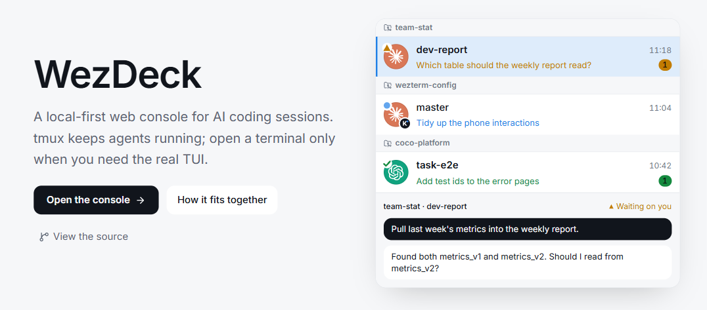

<p align="center">
  
</p>

<h1 align="center">WezDeck</h1>

<p align="center">
  <em>A local-first web console for AI coding sessions, backed by tmux and git worktrees.</em>
</p>

<p align="center">
  <strong>English</strong> · <a href="README.zh-CN.md">简体中文</a>
</p>

<p align="center">
  <a href="LICENSE"></a>
  
  
  
  
</p>

> See every agent session in the web console. tmux keeps the work running; open a terminal when you need the real TUI.

This repository is the source of truth for the WezDeck runtime. The GitHub repo is [`yunsii/wezdeck`](https://github.com/yunsii/wezdeck).

## Design stance

WezDeck is a **control plane** for AI coding sessions. The web console is the daily interface on Windows/WSL; tmux hosts the agents, and WezTerm opens only for direct terminal interaction. Three constraints shape every new interaction. They are also **binding agent guidance** in [`AGENTS.md` · Design stance](AGENTS.md#design-stance) / Hard Rules.

| Constraint | What it means in practice |
|---|---|
| **Keyboard-first** | Every new or changed interaction has a keyboard path; mouse is fallback only. The web console and terminal each expose their own shortcuts. |
| **Headless verify for agents** | Agents use the configured browser backend; the CDP path runs headless without stealing GUI focus. |
| **Observable development process** | Hot paths emit structured signals so a day can be reconstructed, latency gated, and habits reviewed — not guessed from memory. Blind features (no badge / log / projector path) are incomplete. |

The third constraint is load-bearing for iteration: web status and logs expose attention and failures, while day/week projectors turn those signals into a reviewable loop. Longer narrative: [`docs/presentations/`](docs/presentations/).

## ✨ Highlights

- **Sessions in one web view** — inspect conversations, send messages, answer prompts, and find work waiting on you from desktop or phone.
- **Persistent tmux execution** — each worktree has a tmux window and agent pane; `agent-launcher.sh` resumes the conversation when its process restarts.
- **Live attention** — agent hooks feed `attention.json`; the web list surfaces waiting, running, and completed sessions.
- **Keyboard paths in the web console** — search with `/`, move through sessions with `j` / `k`, and open the real terminal with `o` on the host.
- **Worktree creation from the web** — 新会话 starts an agent in a linked worktree with its own purpose.
- **Terminal on demand** — a minimal WezTerm client attaches to a chosen tmux pane for direct TUI use or a human-run script.
- **Observable host** — structured Runtime / relay logs and day/week projectors make failures and working habits reviewable.

## 🎛️ Workbench · A day in the loop

> Open the web console, choose a session, and work in its conversation. tmux
> keeps the agent running when the browser or terminal closes.

```text
need arises
  → open the web console → search / or move through sessions with j / k
       └─ no suitable session → New session creates a worktree and agent
  → read, send, and resolve prompts in the same conversation
       └─ direct TUI or human-run script → open its tmux pane on demand
  → verify in the configured browser or VS Code
  → deliver onto origin/HEAD → recycle (next round) / reclaim (direction done)
```

| Stage | Capability | Deep dive |
|---|---|---|
| Find a session | Web list and search; create a worktree when needed | [Workspaces](docs/workspaces.md) |
| Continue after restart | **`<base>-resume`** via `agent-launcher.sh` keeps the pane's conversation | [Architecture · startup](docs/architecture.md#startup-invariants) |
| Work through attention | Web waiting / done / running states and keyboard navigation | [Agent attention](docs/agent-attention.md) |
| Verify | Open the configured browser with **`wezdeck-browser`** or use VS Code | [Browser debug](docs/browser-debug.md) |
| Close the round | Mainline delivery (no PR) → **`worktree-task recycle`** / reclaim | [Maintenance loop](docs/workspaces.md#maintenance-loop-wezdeck-standing-policy) |
| Review the day / week | Timeline + habit report from the same signals | [Diagnostics · timeline](docs/diagnostics.md#workflow-timeline) · [Habit report](docs/diagnostics.md#habit-report) |

## 📡 Observability surface

Three layers share one idea: **if you cannot see it, you cannot improve it.**

### Optional full GUI status

The web console is the daily attention surface. The retained full WezTerm
configuration can still show the status segments below; the minimal
on-demand terminal uses tmux's status line:

`IME` · `Ego·…`/`CDP·…` · `◆ SessionBridge·N` · plugin badges · `SystemDisk·…`/`WslDisk·…` · `Memory·…` · `LoadAvg·…` · attention counters

| Segment | Meaning | Deep dive |
|---|---|---|
| `Ego·Alive/-/?` or `CDP·Headless/Visible/-/?·port` | Browser slot follows `WEZDECK_BROWSER_BACKEND`; glossary: [browser-glossary](docs/browser-debug.md#browser-glossary) | [Browser debug](docs/browser-debug.md) |
| `◆ SessionBridge·N` | Session-bridge watch poller | [session-bridge](openclaw/docs/session-bridge.md) |
| plugin badges | Contributed by enabled plugins, e.g. the optional `contrib/plugins/oppo-remote` link quality (`OppoRemote·…`) | [Plugins](docs/plugin-architecture.md) |
| `SystemDisk·…` / `WslDisk·…` | Host volume headroom (system + WSL `ext4.vhdx`) | [Host disk](docs/host-disk.md) |
| `Memory·…` / `Swap·…` | Guest memory pressure / earlyoom proximity | [Guest OOM](docs/guest-oom.md) |
| `LoadAvg·…` | Guest CPU load (typing-stickiness early warning) | [Diagnostics · load](docs/diagnostics.md#guest-load-badge-loadavg) |
| `▲ / ✓ / ●` | Waiting / done / running attention | [Agent attention](docs/agent-attention.md) |

### Structured logs + latency (why did it feel sticky?)

- WSL `runtime.log` + Windows `wezterm.log` / `helper.log` — category-scoped rows (`attention`, `hotkey`, `latency`, …).
- Threshold-gated slow hotkey / status-tick rows; slow samples attach guest pressure from the same `Memory·` status file.
- Operator entry: [`docs/diagnostics.md`](docs/diagnostics.md) · author conventions: [`docs/logging-conventions.md`](docs/logging-conventions.md) · report: `scripts/dev/latency-report.sh`.

### Day / week reconstruction (review & optimize)

| Projector | Question it answers | Entry |
|---|---|---|
| **Workflow timeline** | How did I move through workspaces / worktrees / attention / host verify today? | `scripts/dev/workflow-timeline.sh` · [docs](docs/diagnostics.md#workflow-timeline) |
| **Habit report / weekly** | Agent concurrency, skills/MCP/CLI, verify→iterate, hotkey intensity, optional WakaTime / Rime / git churn | `scripts/dev/habit-report.sh` · skill `habit-weekly` · [docs](docs/diagnostics.md#habit-report) |

```bash
scripts/dev/workflow-timeline.sh --summary
scripts/dev/habit-report.sh --days 7
# weekly write-up: load skill habit-weekly → skills/habit-weekly/run.sh
```

## 🧭 How It Works

```
Web console ── local Runtime / remote relay ── tmux session
                                             └─ worktree window
                                                └─ agent pane
                                                     ↑
agent hooks ── attention.json ── web status and notifications
terminal on demand ──────────────┘
structured logs ── timeline / habit projectors
```

Full architecture, ownership boundaries, and the WSL ⇄ Windows channels: [`docs/architecture.md`](docs/architecture.md). Session + interop map (workspace/tab/tmux/worktree/agent/attention ↔ session-bridge ↔ Feishu): [Session & Interop Overview](docs/architecture.md#session--interop-overview).

## ✅ Requirements

| | Required | Notes |
|---|---|---|
| **WezTerm** | nightly | Used for the on-demand terminal client and runtime sync probe on Windows/WSL |
| **tmux** | ≥ 3.7 (recommend **3.8**) | DEC sync 3.6+; copy-mode live refresh 3.7+ (`refresh-from-pane`) / 3.8+ (`refresh-now`). Prefer OS/brew when ≥ 3.7; user-prefix `~/.local` only if distro is older (e.g. Ubuntu apt 3.4). Upgrade: `install-tmux-user.sh --force 3.8`. [Install](docs/tmux-install.md) · [Why](docs/ime-flicker-and-sync-output.md) |
| **lua5.4** | recommended | Powers the sync precheck; missing → precheck skipped with a warning |
| **jq** | recommended | Agent-attention writer & focus path; missing → degraded labels |
| **go ≥ 1.21** | optional | For maintainers of `native/picker/`. End users get a sha256-pinned prebuilt tarball via the release fetcher |
| **python3** | optional | Habit / timeline projectors; WakaTime status |

Supported runtime modes: `hybrid-wsl` (Windows Runtime + WSL/tmux, with WezTerm on demand) and `posix-local` (Linux / macOS local terminal).

## 🚀 Quick Start

```bash
# 1. Seed your machine-local config
cp -r wezterm-x/local.example/ wezterm-x/local/
$EDITOR wezterm-x/local/constants.lua   # runtime_mode, default_domain, shell, …
$EDITOR wezterm-x/local/shared.env      # WAKATIME_API_KEY, MANAGED_AGENT_PROFILE, …

# 2. Sync the runtime into $HOME (writes ~/.wezterm.lua + ~/.wezterm-x/)
skills/wezdeck-runtime-ops/scripts/sync-runtime.sh

# 3. Start the host services without a resident WezTerm window
scripts/dev/install-headless-runtime-startup.sh
scripts/dev/install-remote-relay.sh

# 4. Open the deployed web console on the host
#    This host: https://wezdeck.yuns.love/console/sessions
```

Full setup walkthrough: [`docs/setup.md`](docs/setup.md) · [Remote access](docs/remote-access.md). Optional guards on WSL hosts: [`docs/guest-oom.md`](docs/guest-oom.md) · [`docs/host-disk.md`](docs/host-disk.md).

## 📚 Documentation

**Get started**
- [Setup](docs/setup.md) · [Daily workflow](docs/daily-workflow.md) · [Workspaces](docs/workspaces.md) · [Presentations](docs/presentations/)

**Daily use**
- [Keybindings](docs/keybindings.md) · [tmux UI](docs/tmux-ui.md) · [Agent attention](docs/agent-attention.md) · [Browser debug](docs/browser-debug.md)

**Observability & ops**
- [Diagnostics](docs/diagnostics.md) (latency · [workflow timeline](docs/diagnostics.md#workflow-timeline) · [habit report](docs/diagnostics.md#habit-report)) · [Guest OOM](docs/guest-oom.md) (`Memory·`) · [Host disk](docs/host-disk.md) (`WslDisk·`) · [Logging conventions](docs/logging-conventions.md)

**Internals**
- [Architecture](docs/architecture.md) · [Performance](docs/performance.md) · [IME & sync output](docs/ime-flicker-and-sync-output.md) · [Dev-env troubleshooting](docs/development-environment-troubleshooting.md)

**Releases**
- [WezDeck Runtime](docs/wezdeck-runtime-release.md) · [Picker](docs/picker-release.md)

Docs map: [`docs/README.md`](docs/README.md). Agent rules: [`AGENTS.md`](AGENTS.md). Reusable user-level profiles: [`agent-profiles/`](agent-profiles/). Chinese twin: [`README.zh-CN.md`](README.zh-CN.md) — keep in structural sync (repo-hygiene L0 checks heading outline, relative links, fences/tables, and durable tokens).

## 🎨 Brand

Brand SVGs and the geometric construction notes live in [`assets/brand/`](assets/brand/) — see [`assets/brand/README.md`](assets/brand/README.md) for the asset table and proportional rules.

## 📄 License

MIT © Yuns. See [LICENSE](LICENSE).
