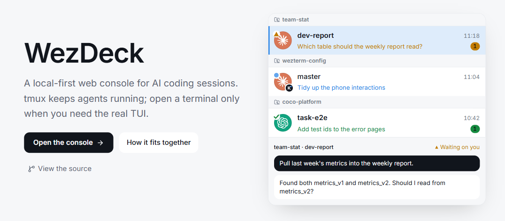

<p align="center">
  
</p>

<h1 align="center">WezDeck</h1>

<p align="center">
  <em>本地优先的 AI 编程会话网页控制台，由 tmux 与 git worktree 承载执行。</em>
</p>

<p align="center">
  <a href="README.md">English</a> · <strong>简体中文</strong>
</p>

<p align="center">
  <a href="LICENSE"></a>
  
  
  
  
</p>

> 在网页里查看所有 Agent 会话。tmux 持续运行任务，需要真实 TUI 时再打开终端。

本仓库是 WezDeck 运行时的单一事实来源。GitHub 仓库：[`yunsii/wezdeck`](https://github.com/yunsii/wezdeck)。

## 设计立场

WezDeck 是 AI 编程会话的**控制面**。在 Windows/WSL 上，网页控制台是日常入口，tmux 承载 Agent，只在需要直接操作 TUI 时打开 WezTerm。三条约束贯穿每一次新交互，也写在 [`AGENTS.md` · Design stance](AGENTS.md#design-stance) / Hard Rules 里。

| 约束 | 实践含义 |
|---|---|
| **键盘优先** | 每个新增或改动的交互必须有键盘路径；鼠标仅作兜底。网页与终端各自提供快捷键。 |
| **Agent 无头验证** | Agent 使用已配置的浏览器后端；CDP 路径无头运行，不抢 GUI 焦点。 |
| **开发过程可观测** | 热路径发出结构化信号，便于复盘一天、门控延迟、优化习惯——而不是靠记忆猜。没有徽章 / 日志 / 投影路径的功能视为**未完成**。 |

第三条是迭代的承重约束：网页状态和日志呈现 attention 与故障，日/周投影把同一批信号变成可复盘闭环。长文见 [`docs/presentations/`](docs/presentations/)。

## ✨ 亮点

- **网页汇总所有会话** — 在电脑或手机上查看对话、发消息、回答确认，并找到等你处理的任务。
- **tmux 持续执行** — 每个 worktree 对应一个 tmux 窗口和 Agent pane，进程重启时由 `agent-launcher.sh` 续聊。
- **实时 attention** — Agent hooks 写入 `attention.json`，网页列表显示 waiting、running 和 done。
- **网页键盘路径** — `/` 搜索，`j` / `k` 切换会话，本机按 `o` 打开真实终端。
- **从网页新建 worktree** — 「新会话」在 linked worktree 中启动 Agent，并记录用途。
- **按需打开终端** — 极简 WezTerm 客户端连接指定 tmux pane，供直接操作 TUI 或执行人工交接脚本。
- **宿主机可观测** — 结构化 Runtime / relay 日志与日/周投影支持故障排查和习惯复盘。

## 🎛️ 工作台 · 一天的主循环

> 打开网页控制台，选一个会话，在同一条对话里处理工作。浏览器或终端关闭后，tmux 仍维持 Agent 进程。

```text
需求出现
  → 打开网页控制台 → 用 / 搜索或 j / k 切换会话
       └─ 没有合适会话 → 「新会话」创建 worktree 与 Agent
  → 在同一条对话里阅读、发送消息、处理确认
       └─ 需要真实 TUI 或人工脚本 → 按需打开 tmux pane
  → 在已配置的浏览器或 VS Code 中验证
  → 交付到 origin/HEAD → recycle（下一轮）/ reclaim（方向收尾）
```

| 阶段 | 能力 | 深入阅读 |
|---|---|---|
| 找到会话 | 网页列表和搜索；需要时新建 worktree | [Workspaces](docs/workspaces.md) |
| 重启后续聊 | `agent-launcher.sh` 的 **`<base>-resume`** 维持 pane 的对话 | [Architecture · startup](docs/architecture.md#startup-invariants) |
| 处理 attention | 网页的 waiting / done / running 状态及键盘导航 | [Agent attention](docs/agent-attention.md) |
| 验证 | 用 **`wezdeck-browser`** 打开已配置浏览器，或使用 VS Code | [Browser debug](docs/browser-debug.md) |
| 收尾本轮 | 主线交付（无 PR）→ **`worktree-task recycle`** / reclaim | [Maintenance loop](docs/workspaces.md#maintenance-loop-wezdeck-standing-policy) |
| 复盘日 / 周 | 同一批信号上的 timeline + habit 报告 | [Diagnostics · timeline](docs/diagnostics.md#workflow-timeline) · [Habit report](docs/diagnostics.md#habit-report) |

## 📡 可观测面

三层共用一个想法：**看不见，就无法改进。**

### 备用完整配置的状态栏

网页列表是日常 attention 面。保留的完整 WezTerm 配置仍可显示下列状态段；按需打开的极简终端使用 tmux 状态行：

`IME` · `Ego·…`/`CDP·…` · `◆ SessionBridge·N` · 插件徽章 · `SystemDisk·…`/`WslDisk·…` · `Memory·…` · `LoadAvg·…` · attention 计数

| 段 | 含义 | 深入阅读 |
|---|---|---|
| `Ego·Alive/-/?` 或 `CDP·Headless/Visible/-/?·port` | 浏览器槽（browser slot）跟 `WEZDECK_BROWSER_BACKEND`；术语表见 [glossary](docs/browser-debug.md#browser-glossary) | [Browser debug](docs/browser-debug.md) |
| `◆ SessionBridge·N` | session-bridge watch 轮询器 | [session-bridge](openclaw/docs/session-bridge.md) |
| 插件徽章 | 由已启用插件提供，例如可选插件 `contrib/plugins/oppo-remote` 的链路质量（`OppoRemote·…`） | [Plugins](docs/plugin-architecture.md) |
| `SystemDisk·…` / `WslDisk·…` | 主机卷余量（系统盘 + WSL `ext4.vhdx`） | [Host disk](docs/host-disk.md) |
| `Memory·…` / `Swap·…` | Guest 内存压力 / earlyoom 临近 | [Guest OOM](docs/guest-oom.md) |
| `LoadAvg·…` | Guest CPU 负载（打字粘滞早期预警） | [Diagnostics · load](docs/diagnostics.md#guest-load-badge-loadavg) |
| `▲ / ✓ / ●` | waiting / done / running attention | [Agent attention](docs/agent-attention.md) |

### 结构化日志 + latency（为什么手感粘？）

- WSL `runtime.log` + Windows `wezterm.log` / `helper.log` — 按 category 分行（`attention`、`hotkey`、`latency` …）。
- 阈值门控的慢热键 / status tick 行；慢样本会附带与 `Memory·` 同源的 guest 压力字段。
- 操作入口：[`docs/diagnostics.md`](docs/diagnostics.md) · 作者约定：[`docs/logging-conventions.md`](docs/logging-conventions.md) · 报告：`scripts/dev/latency-report.sh`。

### 日 / 周重建（复盘与优化）

| 投影器 | 回答的问题 | 入口 |
|---|---|---|
| **Workflow timeline** | 今天如何在 workspace / worktree / attention / 宿主验证之间移动？ | `scripts/dev/workflow-timeline.sh` · [文档](docs/diagnostics.md#workflow-timeline) |
| **Habit report / weekly** | Agent 并发、skills/MCP/CLI、verify→iterate、热键强度，以及可选 WakaTime / Rime / git churn | `scripts/dev/habit-report.sh` · skill `habit-weekly` · [文档](docs/diagnostics.md#habit-report) |

```bash
scripts/dev/workflow-timeline.sh --summary
scripts/dev/habit-report.sh --days 7
# 周报成文：加载 skill habit-weekly → skills/habit-weekly/run.sh
```

## 🧭 工作原理

```
网页控制台 ── 本机 Runtime / 远程 relay ── tmux session
                                          └─ worktree window
                                             └─ agent pane
                                                  ↑
Agent hooks ── attention.json ── 网页状态与通知
按需打开终端 ────────────────────┘
结构化日志 ── timeline / habit 投影器
```

完整架构、所有权边界与 WSL ⇄ Windows 通道：[`docs/architecture.md`](docs/architecture.md)。会话与互通总览（workspace/tab/tmux/worktree/agent/attention ↔ session-bridge ↔ 飞书）：[Session & Interop Overview](docs/architecture.md#session--interop-overview)。

## ✅ 依赖

| | 要求 | 说明 |
|---|---|---|
| **WezTerm** | nightly | 在 Windows/WSL 上用于按需终端客户端和运行时同步探针 |
| **tmux** | ≥ 3.7（推荐 **3.8**） | DEC sync 需 3.6+；copy-mode 实时刷新需 3.7+（`refresh-from-pane`）/ 3.8+（`refresh-now`）。系统/brew 包 ≥ 3.7 优先；仅当发行版过旧（如 Ubuntu apt 3.4）才用用户前缀 `~/.local`。升级：`install-tmux-user.sh --force 3.8`。[安装](docs/tmux-install.md) · [原因](docs/ime-flicker-and-sync-output.md) |
| **lua5.4** | 推荐 | 驱动 sync 预检；缺失则跳过预检并警告 |
| **jq** | 推荐 | Agent-attention 写入与焦点路径；缺失则标签降级 |
| **go ≥ 1.21** | 可选 | 仅 `native/picker/` 维护者需要。终端用户经 release fetcher 拿 sha256 钉死的预编译包 |
| **python3** | 可选 | Habit / timeline 投影器；WakaTime 状态 |

支持的运行时模式：`hybrid-wsl`（Windows Runtime + WSL/tmux，WezTerm 按需打开）与 `posix-local`（Linux / macOS 本地终端）。

## 🚀 快速开始

```bash
# 1. 播种本机配置
cp -r wezterm-x/local.example/ wezterm-x/local/
$EDITOR wezterm-x/local/constants.lua   # runtime_mode, default_domain, shell, …
$EDITOR wezterm-x/local/shared.env      # WAKATIME_API_KEY, MANAGED_AGENT_PROFILE, …

# 2. 同步运行时到 $HOME（写入 ~/.wezterm.lua + ~/.wezterm-x/）
skills/wezdeck-runtime-ops/scripts/sync-runtime.sh

# 3. 启动宿主服务，无须常驻 WezTerm 窗口
scripts/dev/install-headless-runtime-startup.sh
scripts/dev/install-remote-relay.sh

# 4. 在主机浏览器打开部署好的网页控制台
#    本机实例：https://wezdeck.yuns.love/console/sessions
```

完整安装：[`docs/setup.md`](docs/setup.md) · [远程访问](docs/remote-access.md)。WSL 主机可选守卫：[`docs/guest-oom.md`](docs/guest-oom.md) · [`docs/host-disk.md`](docs/host-disk.md)。

## 📚 文档

**入门**
- [Setup](docs/setup.md) · [Daily workflow](docs/daily-workflow.md) · [Workspaces](docs/workspaces.md) · [Presentations](docs/presentations/)

**日常使用**
- [Keybindings](docs/keybindings.md) · [tmux UI](docs/tmux-ui.md) · [Agent attention](docs/agent-attention.md) · [Browser debug](docs/browser-debug.md)

**可观测与运维**
- [Diagnostics](docs/diagnostics.md)（latency · [workflow timeline](docs/diagnostics.md#workflow-timeline) · [habit report](docs/diagnostics.md#habit-report)）· [Guest OOM](docs/guest-oom.md)（`Memory·`）· [Host disk](docs/host-disk.md)（`WslDisk·`）· [Logging conventions](docs/logging-conventions.md)

**内部机制**
- [Architecture](docs/architecture.md) · [Performance](docs/performance.md) · [IME & sync output](docs/ime-flicker-and-sync-output.md) · [Dev-env troubleshooting](docs/development-environment-troubleshooting.md)

**发布**
- [WezDeck Runtime](docs/wezdeck-runtime-release.md) · [Picker](docs/picker-release.md)

文档地图：[`docs/README.md`](docs/README.md)。Agent 规则：[`AGENTS.md`](AGENTS.md)。可复用用户级 profile：[`agent-profiles/`](agent-profiles/)。英文版：[`README.md`](README.md) — 与本文件保持结构同步（repo-hygiene L0 校验标题层级、相对链接、代码块/表格数量与耐久 token）。

> 专题文档目前以英文为主；叙事向长文（含中文）见 [`docs/presentations/`](docs/presentations/)。

## 🎨 品牌

品牌 SVG 与几何构造说明在 [`assets/brand/`](assets/brand/) — 资源表与比例规则见 [`assets/brand/README.md`](assets/brand/README.md)。

## 📄 许可

MIT © Yuns. 见 [LICENSE](LICENSE)。
