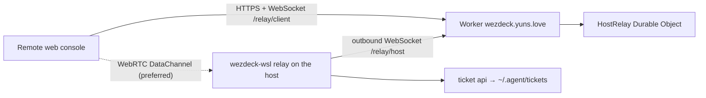

# Remote access (remote web console → sessions and tickets)

Status: **live** (2026-11-22). A paired remote web console opens
`https://wezdeck.yuns.love/console/sessions` from anywhere: collab tickets, runs and
transcripts, every live agent session on the host (read its conversation,
send it a message, answer its confirmation dialog), and replies to tickets
waiting on you. Writes need a device key the host approved once.

Agent coding from the phone is still OpenClaw ([`mobile-access.md`](./mobile-access.md));
this doc covers the structured ticket view.

Terms (host, terminal, local / remote web console, desktop / mobile,
device): [`architecture.md#terms`](./architecture.md#terms).

## Shape



| Part | Code |
| --- | --- |
| Worker entry (`/relay/*` → DO, rest → TanStack Start SSR) | `web/src/server.ts`, `web/wrangler.jsonc` |
| HostRelay DO (forwarding, presence, auth) | `web/src/relay/host-relay.ts` |
| Browser link (WebRTC first, WebSocket fallback, latency) | `web/src/lib/remote-link.ts`, badge `web/src/features/remote-badge.tsx` |
| Collab reads choose loopback Runtime or the link | `getCollab` in `web/src/lib/runtime-client.ts` |
| Host side | `native/wezdeck-wsl/relay.go` (`wezdeck-wsl relay`) |
| Install / tokens / pairing | `scripts/dev/install-remote-relay.sh` |
| Acceptance | `web/tests/remote.cdp.test.ts` |

- The host only dials **out**; no port is opened and NAT does not matter.
- The DO only forwards frames. What can run is decided on the host by the same
  allowlist as the Runtime bridge (`collabFlags` in `collab.go`): read actions
  only, values regex-checked.
- On the host itself the page keeps using the loopback Runtime; the remote
  link starts only when loopback is unreachable (or with `?remote=1`).

## Transport order

1. The browser opens `wss://…/relay/client` (always kept: presence,
   signaling, fallback).
2. When the host is online it offers a WebRTC DataChannel (STUN
   `stun.cloudflare.com`, non-trickle: SDP carries all candidates, one
   round trip over the relay socket). pion on the host answers.
3. DataChannel open → requests and pings move to it; the relay carries
   nothing else. Not open within 15 s or ICE failed → stay on the WebSocket
   relay, retry WebRTC every 60 s.

Why direct often fails on a phone, and the mic button: mobile browsers hide
their LAN address behind mDNS (`xxxx.local`); the host cannot resolve it
(multicast replies do not reach WSL) and cannot be dialed first either — the
Hyper-V firewall blocks all inbound to WSL (`DefaultInboundAction: Block`),
and opening it on a work machine is not the trade we want. So while on the
relay after a failed attempt the badge offers **授权以局域网直连**: a
microphone grant makes the browser offer its real address (stream closed
immediately, nothing recorded — fe1's meeting-link trick), the host then dials
out and the stateful firewall lets the replies in. It only helps on the same
LAN; across networks direct needs hole punching or TURN. The host's answer
carries `samePublic`, so the button is hidden when the device is on another
network and the badge tooltip says hole punching failed.

`rtc_answer` log rows carry `offer_cands` / `answer_cands` (counts per
candidate type, `mdns=` for hidden host addresses) and `same_public=yes|no|unknown`
(both sides' STUN addresses equal or not; addresses are not logged). First
phone records: `host=4(mdns=4) srflx=2 same_public=no` → ICE failed after
30 s every time (phone and the office host on different networks; the office
side / VPN blocks UDP hole punching). Steady state there is the WebSocket
relay unless TURN is added.

No TURN yet: when hole punching fails (common on carrier CGNAT) the
WebSocket relay is the fallback. `?transport=websocket` forces it.

## Sessions

What the relay answers about agent sessions — the session RPCs (list,
transcript, send, keys, new session / ticket, clear), local reads for a
browser on the host, attachments, repo to-dos, diagnostics on demand,
account limits and the agent adapter contract — lives in
[`remote-sessions.md`](./remote-sessions.md). Writes among them are signed
as described next.

## Writes: device keys

The remote web console creates an ECDSA P-256 key in the browser (non-extractable,
IndexedDB `wezdeck-device`) and registers its public half; the host approves
it once:

```bash
scripts/dev/install-remote-relay.sh --devices          # pending / approved
scripts/dev/install-remote-relay.sh --approve <id>     # id = sha256(pub)[:8] hex, shown in the web console
scripts/dev/install-remote-relay.sh --revoke <id>
```

Each write carries `{device, payload, sig}`: the host verifies the signature
over the exact payload text, then uses only the signed `action` / `args`,
rejects a clock skew over 2 min and any reused nonce (seen nonces kept 5 min
in `remote-nonces.json` beside the store, so a restart does not reopen the
window; `nonce_store.go`). Message text is pasted with ESC / control
characters dropped (`paste_safe.go`): an embedded `ESC[201~` ended the paste
and the rest typed keys (Shift+Tab) past the `key` allowlist. Store:
`~/.config/wezdeck/remote-devices.json` (0600); `relay.log` is 0600 too. Cloudflare (or anyone holding
the pairing token) can read but cannot forge a write. Logs: `event=write` /
`event=write_denied` rows with device id.

Hardening (2026-11-23 review): the device store is read-modify-written by
both the relay (register) and `install-remote-relay.sh` (approve / revoke)
under one `flock` on `remote-devices.json.lock`, and the relay writes it
atomically (tmp + rename), so a revoke cannot be undone by a racing register;
device names drop control characters (stored and printed) so `--devices`
cannot be spoofed with escape sequences. A device also sends `info`
(`clientInfo` in `device-state.ts`: Chromium's UA client hints — real
brand, major version, OS version, model — else the UA parsed by `bowser`,
MIT; ua-parser-js 2.x is AGPL — plus standalone, language, screen, the UA
clipped to 300) and every page load refreshes it and `seen_at` (written
only when the info changed or an hour passed); `--devices` prints
"Chrome 157 · Android 16 · model", added, last seen. The name used to be
the UA's first "(…)" — "Linux" for a Chrome phone (frozen UA), "Android 16"
for Firefox — too little to pick the device to revoke. A pairing-token rotation also sends
the host `bye` for every evicted cid, closing that client's WebRTC peer, not
only its DO socket. `diag.submit` accepts chunks only from the cids the
request was pushed to, once each. A `#pair=` link must look like a token
(`[A-Za-z0-9_-]{16,128}`) and needs a confirmation before it replaces a
different token on the device. Each paste uses its own tmux buffer, a resent
upload chunk counts toward the 8 MB limit, relay log `action=` values are
quoted, `session.image` serves only listed sessions, and `ticket attach`
rejects a recorded session id that is not `[A-Za-z0-9_-]{1,128}`.

## Badge

The collab header shows the link when the page is remote:

| Badge | Meaning |
| --- | --- |
| `WebRTC 直连 · 局域网 · N ms` | DataChannel, host-side address private |
| `WebRTC 直连 · 公网 · N ms` | DataChannel through NAT / public IPv6 |
| `WebSocket 中转 · N ms` | via the Durable Object |
| `主机离线` | host socket not connected (DO presence) |
| `令牌无效，请重新配对` | handshake refused (checked via `/relay/auth`) or evicted with close 4401 after a token rotation; no retry loop |

N = median of the last 5 round trips (ping every 2 s, end-to-end to the host
process). Hover shows the last WebRTC failure. Data attributes
(`data-mode`, `data-path-detail`, `data-rpc-webrtc`, `data-rpc-websocket`)
are what the acceptance test reads.

Measured 2026-11-21 (same home LAN, production):

| Client | WebRTC | WebSocket relay |
| --- | --- | --- |
| Windows Chrome → WSL host | LAN, `host↔host 192.168.3.55`, 1 ms | 85 ms |
| WSL headless Chromium | public IPv6 host candidate, 1 ms | 91 ms |

## Protocol

JSON text frames with `t`:

| Direction | Frames |
| --- | --- |
| browser → DO | `rpc {id, action, args}` · `sig {data: offer}` · `ping {id}` |
| DO → host | same plus `cid` (one per browser socket) · `bye {cid}` |
| host → DO | `res {cid, id, ok, result\|error}` · `sig {cid, data: answer}` · `pong {cid, id}` · `hello` |
| DO → browser | `host {online, since}` · host frames without `cid` |
| DataChannel | `rpc`/`res`, `ping`/`pong` without `cid` |

Host keepalive is the literal text `ping`, answered by
`setWebSocketAutoResponse` without waking the DO. Both sockets use the
hibernation API, so an idle link costs no DO duration; usage stays far
inside the Workers Free allowance.


A reply over 200 KB goes over the DataChannel as `part` frames (`{t:"part", id, seq, total, data}`, 60 KB slices of its JSON text cut on UTF-8 boundaries; `relay_parts.go` → `web/src/lib/reply-parts.ts`): Chrome takes at most 256 KiB per DataChannel message, and a bigger send used to fail silently, leaving the web console to time out. A failed send logs `rtc_send_error`.

## Auth (MVP)

Two random tokens in `~/.config/shell-env.d/wezdeck-remote.env` (0600),
mirrored as Worker secrets `RELAY_HOST_TOKEN` / `RELAY_CLIENT_TOKEN`:

- host: `Authorization: Bearer` on `/relay/host` (an unset secret refuses
  every host — `relay/auth.ts`; "Bearer undefined" used to get in);
- browser: subprotocols `wezdeck.v1, token.<secret>` (browsers cannot set
  WebSocket headers); stored per device in `localStorage` from a
  `#pair=<token>` link (the fragment never reaches the server).

Rotation (`rm` the env file, rerun install + `--push-secrets`) evicts open
browser sockets: each carries a SHA-256 tag of its token, checked by the DO on
every message and on every new connection (the host reconnects with the new
token right away).

Reads need an approved device too (2026-11-24, `relay_auth.go`). The
client token is one secret every paired browser shares, so it names no
device: revoking a device used to drop only its write key while it kept
reading everything (a revoked Firefox did, re-registering right after). Now
each relay connection (cid — its DataChannel is the same cid) first sends
`device.hello`, signed like a write (device key, ts, nonce); the host binds
that cid to the device and checks, on every read, that the device is still
approved — a revoke refuses the next read and drops its WebRTC peer, no
reconnect needed. WebRTC signaling (`sig`, capped at 16 peers) and host
diagnostics pushes / `diag.submit` also require an approved `device.hello`
connection, so an unapproved or revoked browser cannot probe host ICE
candidates or inject diagnostics. Open without `device.hello`:
`device.register`, `device.hello`; writes carry their own signature. The host
keeps the cid → device binding in memory, so a relay
restart (crash, reboot, a release) forgets it while the page's socket to
the Worker stays up: a read refused as not approved on a socket that already
said hello says hello again and retries once (`retriable` in
`remote-auth.ts`; `remote-test-stack.sh restart-relay` reproduces it). The
page says hello once per socket (`remote-link.ts`) and maps
the refusal to "not approved — 我的 › 设备授权" (`remote-auth.ts`); a new
device requests access there (the button was 启用写入). Logs:
`device_register` (cid, device id, state), `device_hello` (ok / err),
`read_denied` (cid, action). The test stack runs `WEZDECK_RELAY_OPEN_READS=1`
(honoured only with a private `WEZDECK_ATTENTION_FILE`: its browsers' keys
cannot be pre-approved); `WEZDECK_TEST_GATED_READS=1` starts it gated to
walk approve → read → revoke by hand. `/relay/health` requires
`Authorization: Bearer <client or host token>` (`--check` loads and sends the
client token) and returns `401` without touching the Durable Object otherwise.

Writes add device signatures (above). Cloudflare Access in front of
`/console` + `/relay/client` and pinned DTLS fingerprints remain follow-ups
([open questions](./diagnostics.md#open-questions)); Access is not enabled on
the account yet.

## Cost and free tier

Everything runs on the Cloudflare **Workers Free** plan; nothing here can
produce a bill — over a limit, that kind of call fails until 00:00 UTC
(08:00 Beijing) and then works again. Checked against the official
[Durable Objects pricing](https://developers.cloudflare.com/durable-objects/platform/pricing/)
in 2026-11:

| Resource | What uses it | Free limit / day |
|---|---|---|
| Worker requests | SSR pages, the relay handshake, `/relay/auth`, `/relay/health`, `/relay/usage` (static assets are free) | 100,000 |
| Durable Object requests | the `HostRelay` object: each WebSocket **upgrade** is 1, **incoming** WebSocket messages count **20:1**; outgoing messages and protocol pings are free | 100,000 |
| Durable Object duration | 128 MB × wall time while the object is active and cannot hibernate | 13,000 GB-s |

Why WebSocket stays cheap here: `HostRelay` uses the hibernation API
(`ctx.acceptWebSocket`), so between messages it is hibernation-eligible and
bills no duration even with a web console and the host connected all day; the host's
keepalive `ping` is answered by `setWebSocketAutoResponse` (no wake, no
time). What is billed is the incoming messages: every RPC is two (web console →
relay, host → relay) and the web console's RTT ping every 2 s is two more. The
busiest hour in the relay log (2026-11-22) had 810 WebSocket RPCs: ≈ 1,620
+ 3,600 ping messages ≈ 5,400 incoming / h ≈ 270 requests / h — a full day
at that rate is ≈ 6,500 of the 100,000 Durable Object requests. A direct
WebRTC DataChannel bypasses the relay and costs nothing. Free plan requires
SQLite-backed Durable Objects (`new_sqlite_classes` in `wrangler.jsonc`).

**Usage card** (我的 › 用量, `console-usage.tsx` → host `usage` → `/relay/usage`,
`relay/usage.ts`, adapted from forge's admin usage page): today's Worker
requests, Durable Object requests / duration and WebSocket messages in /
out against those limits, from the Cloudflare GraphQL Analytics API,
cached 5 minutes. Analytics count every message while billing counts
incoming ones 20:1, so the card computes the billable number itself:
`durableObjectsInvocationsAdaptiveGroups` grouped by `type` —
`hibernation` is one incoming WebSocket message delivered to the
hibernating relay (the periodic dataset's `inboundWebsocketMsgCount` stays
0 under hibernation), `http` is upgrades and presence fetches — billable =
http + ⌈hibernation ÷ 20⌉. `durableObjectsPeriodicGroups` (`activeTime` in
µs, `outboundWebsocketMsgCount`) cannot filter by script, so it is summed
over the `namespaceId`s the invocations reported; `workersInvocationsAdaptive`
filters by `scriptName`. Measured 2026-11-22 (UTC day, ≈ 13 h in): Worker
949 requests; relay 245 http + 30,505 messages ≈ 1,771 billable of 100,000;
active 16.5 s ≈ 2 GB-s of 13,000. The card shows relay duration as time
(GB-s ÷ 0.128 — the relay's fixed 128 MB, counted decimal as Cloudflare's
pricing examples do, "seconds * 128 MB / 1 GB": 13,000 GB-s ≈ 28.2 h a day);
GB-s itself is explained once, in words, under 怎么计费 (zh 「GB-秒」, the
domestic clouds' rendering; Cloudflare's own zh pages keep "GB-s"), never as
a bare ratio. Numbers keep to one line (the name wraps instead). The token lives in the account that owns
the Worker (`Yuns.xie@qq.com's Account`, where `wrangler whoami` points),
named `wezdeck usage (analytics read)`. It needs two Worker secrets — an
API token with only **Account › Account Analytics › Read** and the account
id:

```bash
cd web
npx wrangler secret put CF_ANALYTICS_TOKEN   # paste the read-only token
npx wrangler secret put CF_ACCOUNT_ID        # the account id (dashboard / wrangler whoami)
```

Without them the card says so and shows dashes. The page asks the host
(`usage` over the relay, a gated read: approved devices only —
`relay_usage.go`), and the host fetches `/relay/usage` with the host token,
the only credential the Worker accepts there (401 otherwise; it never wakes
the relay object). It used to take the shared client token, so a revoked or
never-approved browser still read the account's usage (2026-11-24).

## Testing locally

`scripts/dev/remote-test-stack.sh start [--home DIR]` builds the web app,
serves the production build with the Worker + `HostRelay` on `:3018`
(`vite preview`) and starts a throwaway host relay whose attention file,
device approvals, uploads, Claude status snapshots and a private copy of the
ticket store (new tickets / replies write only the copy; a ticket run and a
new session's open-task-window are stand-ins) all live in a temp dir
(`--home` also points it at fixture transcripts); it prints the `export`
lines the cdp tests need (`WEZDECK_TEST_ATTENTION`, `WEZDECK_TEST_DEVICES`,
`WEZDECK_TEST_UPLOADS`). `stop` ends it; the systemd relay is never touched.
Hand-typed stacks twice forgot `WEZDECK_REMOTE_UPLOADS` and wrote test
uploads into the real uploads dir — use the script.

A second stack beside another session's (another worktree) needs its own
port and a **short** state dir: `WEZDECK_TEST_STACK_PORT=3028
WEZDECK_TEST_STACK_DIR=/tmp/<short> … start`, then `eval` the printed
exports (they include `WEZDECK_REMOTE_URL`). `start` refuses a port that
already answers `/relay/health` — on 2026-11-25 a second stack's relay
joined the first one's `HostRelay` and the two kept replacing each other —
and a state dir over 90 bytes (unix socket paths cap at 108, so
`relay.sock` failed to bind). The relay runs with `WEZDECK_REPO` = the
stack's checkout (its `ticket` CLI is the code under test, not the primary
tree's) and `TICKET_COLLAB_RUN_CMD` = the run stand-in, so a fan-out
approved from the page dispatches nothing real. A worktree also needs
`web/.dev.vars` (gitignored; the stack's dev tokens) copied from the
primary checkout before its first build.

Versions are source fingerprints (`scripts/dev/source-fingerprint.sh DIR`:
the last commit touching it, `-dirty-<hash>` with uncommitted edits; web
tests excluded): the stack builds the web with it as the build id, and
`build.sh` stamps it into the relay, which logs `event=connected
version=…`. Before any cdp test, `web/tests/version.setup.ts` compares the
served `/build.json` and the test relay's version with the working tree and
stops with "restart the stack" on a mismatch — a stale stack once passed for
a real bug (`WEZDECK_SKIP_VERSION_CHECK=1` to probe an old build on purpose).
`ensure [--home DIR]` does that check first — plus the relay HOME the stack
was started with (`$STATE/home`: a stack the release gate restarted without
`--home` once served fixture screenshots from the real HOME) — and keeps a
current stack instead of rebuilding it; `start` skips `vite build` when `web/dist/client/build.json`
already carries the fingerprint (and `build.sh` skips a current relay).
`ensure` also loads the served page's own script: `wezdeck-release.sh`
rebuilds `web/dist` in place under the same fingerprint, and a running
preview kept rendering the old bundle's script name — a 500 on every page
until restarted.

**Run what the change can break, not every suite**:
`scripts/dev/web-affected-tests.sh [--run] [--base REF] [FILE...]` takes the
uncommitted files (or the given ones) and plans `go test` (Go sources
changed), `vitest related` (unit tests the web files' import graph reaches)
and the cdp files whose `// covers:` header globs (repo-relative) match;
cdp falls back to every file when a shared file changed (`lib/`,
`components/`, `routes/`, `styles/`, the Worker relay, build config, the
relay's transport — `SHARED` in the script) or a web / relay source is
covered by no test (an unmapped file is a gap, not a pass). Locales, docs
and unit test files alone select no cdp test. `--run` executes the plan on
`remote-test-stack.sh ensure`. A new cdp test needs its `// covers:` lines;
a new source file belongs in some test's header. The full suites stay for
when the script says `all`.

**Did a switch flash? Measure it frame by frame**:
`scripts/dev/web-frame-probe.sh [sessions|tickets]` drives the test stack in
an ego task space (the agent browser, anonymous profile, the space id kept
under `~/.local/state/wezdeck/web-frame-probe/space` for reuse), presses
rows like a person (down, 120 ms, up) and records every animation frame's
DOM state (title, scroll, the open row's background and box-shadow, sticky
prompt, Loading…, view transitions) plus every painted frame (trace
screenshots — `Page.screencastFrameAck` needs a `sessionId` that ego's
`page.cdp` refuses; they come ~500 px wide, so a 3 px bar is below their
resolution while a filled row is not). `sessions` uses the two newest real
Claude transcripts on throwaway tmux panes (the stack's relay reads the real
HOME; `--ids A,B` picks them, `--status running` shows them running — a
running session's switch jittered where idle ones did not), `tickets` two
tickets of the store copy. A stale cached space id falls back to the named
space. It reports `loading`,
`transition`, `sticky`, `row-fill`, `grey-step` (a dark press veil: white →
grey → blue), `snap` (the pressed row's fill or tint layer stepping instead
of easing), `glide` (painted frames not at the bottom after a session
switch: a scroll animation), `landing` (a conversation's first frame not at its bottom / a
ticket's not at its top), `blank` (sessions: a painted frame with the pane flat, no conversation) and `pixels` findings, plus `jank` warnings
(main-thread stalls; compositor-run opacity still moves), keeps
`frames/*.jpg`, `samples.json` and `summary.json`, exits 1 on a finding and
logs one `category=web_probe` row. Run it before saying a visual flash is
fixed: screenshots and single assertions missed a 70 ms solid-blue row, a
frame at the old scroll offset and a Loading… frame (2026-11-24); reverting
the bar fix makes it report `row-fill` and `pixels` on every press.

## Operate

```bash
scripts/dev/install-remote-relay.sh               # tokens (once) + build + user unit wezdeck-relay.service
scripts/dev/install-remote-relay.sh --push-secrets  # after creating / rotating tokens
scripts/dev/install-remote-relay.sh --pair        # pairing link + QR for the remote device
scripts/dev/install-remote-relay.sh --check       # unit state + /relay/health presence
scripts/dev/wezdeck-release.sh                    # publish primary master (coalesced + L0 smoke gate)
scripts/dev/wezdeck-release.sh --land HEAD        # integrate, push, and wait for coalesced batch
scripts/dev/wezdeck-release.sh status             # inspect coordinator phase, deployed SHA, pending queue
scripts/dev/wezdeck-release.sh rollback           # emergency rollback of Cloudflare worker + relay binary
```

`--land COMMIT` resolves the commit in the task worktree and delegates to the
primary `master`. The pipeline splits into three stages:

1. **Fast land (`wezdeck-land.lock`, ~2–5 s)**: merges onto primary `master`,
   checks i18n catalogs on the merged commit, pushes `origin/master`, records
   the commit in `~/.local/state/wezdeck/release/state.json`, and releases the
   land lock immediately so concurrent worktrees never stall behind builds or
   tests.
2. **Singleton coalesced deploy (`wezdeck-deploy.lock`)**: after a short
   debounce window (`WEZDECK_RELEASE_COALESCE_S=5`, `--now` to skip), builds
   changed artifacts, runs the mandatory **L0 core availability smoke gate**
   (`scripts/dev/release-smoke-gate.sh` + `web/tests/smoke-core.cdp.test.ts` on
   an isolated `:3019` stack: connect, authorize, list/open session, send
   message, answer prompt — aborting before deploy if anything fails), deploys
   only changed `relay`/`web`, verifies the public site with a live canary
   probe (auto-running `wrangler rollback --yes` on failure), and notifies
   connected browsers non-disruptively via `wezdeck-wsl diag --notify-update`
   (shows a sticky "New version available · Reload" toast and waits for a safe
   idle window instead of interrupting active users; pass `--force-reload` for
   immediate device-check reloads). If additional commits landed on
   `origin/master` while a batch was shipping, the coordinator loops once to
   ship all of them together in a single coalesced batch; callers with default
   `--wait` (override with `--no-wait`) return once their commit is an ancestor
   of `deployed_sha`.
3. **Detached async regression (`scripts/dev/release-async-verify.sh`)**: runs
   `web-affected-tests.sh` outside all locks in a dedicated detached worktree
   and automatically cancels stale runs when a newer batch ships.
`WEZDECK_RELEASE_LOCK_WAIT` sets the wait in seconds (300 by default).
The script fetches `origin/master` before integrating. A merge conflict
returns to the task worktree for resolution. If the remote advances during
the build, the script integrates the new tip and retries once with a fresh
build check.

The script builds once per candidate and verifies that the exact commit is
on `origin/master` before deploying either Web or relay. The two deploy jobs
can run together once the push is confirmed. Each skips an already-current
source fingerprint. Use `--only push|relay|web` to select jobs. Deploy-only
runs can fast-forward a clean primary checkout and require it to match the
remote tip. `--force` redeploys current parts. Logs live under
`~/.local/state/wezdeck/release/`, with a separate directory for the retry.

Affected tests run alongside delivery by default. `--gate` waits for them
before push and deployment. `--no-test` skips that run. `--commit MSGFILE`
formats staged Web sources, refreshes the translation catalogs, and commits
on the primary checkout before starting the release. After a Web deploy,
the script reloads connected consoles and checks their build.
`--no-reload` skips the reload.
The relay job repairs a stale systemd `ExecStart` before restarting, then
checks the new process's `event=connected` version. A restart with an old
version is a release failure, even when systemd reports the unit as active.

Logs: `category=relay` rows (`connected` / `disconnected` / `rtc_state` /
`rtc_answer` / `rpc via=webrtc|websocket ms err`) in
`journalctl --user -u wezdeck-relay` and `relay.log` beside
`wsl-bridge.log`; Worker logs via Cloudflare observability.

Relay rooms: `/relay/host?room=<name>` and a page opened with `?room=<name>`
(sticky per tab) share their own Durable Object, so a throwaway test host
never displaces the real one — never stop `wezdeck-relay` to test.

Acceptance (local: `vite dev` with `.dev.vars` + a relay pointed at it;
production: the deployed site, test relay in `room=test`):

```bash
WEZDECK_REMOTE_URL=https://wezdeck.yuns.love WEZDECK_REMOTE_TOKEN=<client token> \
  corepack pnpm exec vitest run --config vitest.cdp.config.ts tests/remote.cdp.test.ts
```

### Host quick controls

In **Settings → This computer**, approved remote devices can connect or
disconnect One Client (WARP) and see OPPO remote-control status. The local
Windows Runtime exposes the same controls to its allowed loopback origins.
The WARP write takes an explicit target state, serializes changes, and
reads back the client state before reporting success. Check the current state
on the page if changing network routes interrupts the connection.

The OPPO row uses the optional sampler's heartbeat for the active session
and O+ Connect's main log for the latest completed connection attempt.
A missing or stale sampler shows an unknown session state. RPC outcomes and
durations are in the relay log under `host.warp.status`, `host.warp.set`,
and `host.oppo.status`. Writes also log the approving device or local origin.
