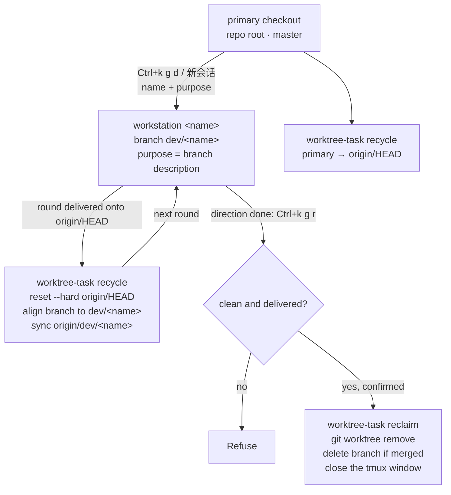

# Workspaces

Use this doc when you need to understand or edit managed workspaces.

## Workspace Model

WezTerm workspaces are the top-level session unit. For the full WezTerm-vs-tmux nesting picture and the cross-layer ownership rule, see [`architecture.md`](./architecture.md#interaction-layers).

- `default`: WezTerm built-in workspace
- `work`: managed business workspace
- `config`: managed config workspace
- `opensource`: managed open-source workspace (personal / `~/github` projects, bound to `Alt+s`)

## Behavior

- If the target workspace already exists, the shortcut switches to it. The switch runs inside a synchronous WezTerm callback, so its cost shows up directly as key-to-repaint latency — WezTerm cannot repaint the new workspace until the callback returns.
- When the existing tabs already match the configured items in order, the switch fast-paths to `mux.set_active_workspace` and skips the reorder/prune loop, so repeated switches stay roughly constant-time regardless of item count. This hot path must not run synchronous WSL subprocesses; capped workspaces use tab-visibility's label fallback instead of `print-session-names.sh` when the target workspace already exists. Without the fast path, a 7-item workspace would pay O(N²) tab matching, per-item `set_title`, optional `MoveTab`, and a final stale-tab scan on every switch, and the delay scales with item count (single-item workspaces such as `config` stay fast either way).
- When the workspace is out of sync (worktree reclaimed, items added or reordered), the next switch pays the full reorder/prune pass once to realign tabs, then later switches return to the fast path.
- If it does not exist, WezTerm creates the workspace window first and then switches to it, opening the first configured project as that workspace's entry window.
- `default` stays the built-in WezTerm workspace at the top level. In `hybrid-wsl`, its WSL tabs still launch into a lightweight single-pane tmux session.
- Non-default managed workspaces use the managed tmux bootstrap with repo-aware session reuse and the shared status layout.
- Each managed project tab boots through `tmux`.
- Each managed git project tab attaches to one tmux session per repo family, even when that repo has multiple linked worktrees.
- Inside that tmux session, each git worktree gets its own tmux window.
- Worktree switching inside that tmux session follows the live git state of the current pane or window layout, so manually created linked worktrees are discoverable without prewritten tmux metadata.
- The `worktree-task` skill creates workstations (linked worktrees) under the repository parent's `.worktrees/<repo>/` directory and opens them as additional tmux windows inside that same repo-family session.
- `Ctrl+k` `g` `d` opens the new-workstation prompt (`scripts/runtime/worktree/create-prompt`): a short direction name and a one-line purpose, with a live preview of the directory and branch; `g r` reclaims the current pane's worktree (see [`keybindings.md`](./keybindings.md#panes) and [Workstations](#workstations)).
- The left pane runs the configured primary command.
- The right pane stays as a shell in the same directory.
- `work` and `config` default to the managed launcher profile from `managed_cli.default_profile`.
- The tracked baseline resolves that profile from `MANAGED_AGENT_PROFILE` in `wezterm-x/local/shared.env` when present; otherwise it falls back through the shared `worktree-task` config and then the built-in Lua default.
- The managed agent startup uses the profile default, and switches to the light variant when `managed_cli.ui_variant = "light"`.
- Profile commands are forked into bare and `-resume` variants. Every wezterm/tmux entry point that creates **or refreshes** an agent pane — workspace first-open of `work` / `config` (the `defaults.launcher` for managed workspaces resolves to `<base>-resume` when that profile is registered), `Ctrl+k g d` (new workstation), the `Alt+g` picker when it spawns a window on demand, `Alt+Shift+G` cycle, the legacy bare-name path of `open-task-window`, and the palette refresh actions (`session.refresh-current-window` / `refresh-current-session` / `refresh-current-workspace`) — launches the agent under the `<base>-resume` profile via `agent-launcher.sh`. Resume prefers a **typed session id** in this order: pane option → durable `agent-session-pins.json` keyed by worktree cwd + `primary|secondary` → `attention.json` for the current pane **only when** `tmux_window_name` matches (pane ids recycle across worktree windows in one repo-family tmux session) → window option; then runs `claude|grok --resume <id>` / `codex resume <id>`. When no usable id exists it falls back to cwd-scoped `claude --continue` / `codex resume --last` / `grok --continue` (the agent CLI's native project isolation), then to a fresh CLI when the cwd has no prior conversation. Claude: upstream also deletes transcripts after `cleanupPeriodDays` (default 30); a pin that outlives the `.jsonl` is skipped and falls through — see [`architecture.md` Claude transcript retention](./architecture.md#claude-transcript-retention-upstream). Primary-pane F5 restores that pane's conversation. Secondary pane remembers **agent vs shell** as current process state: in agent → F5 typed-resumes when an id is known; exited to shell → F5 stays a login shell and drops leftover secondary resume sources (`pane-died`, wrapper Ctrl+C/fallback, and shell-state F5 itself). Primary pins stay so F5 remains the bring-back path there. After `tmux kill-server`, `tmux_worktree_ensure_window_panes` recreates a secondary agent only when its durable pin still says agent (not cleared by an exit to shell). The bare `claude` / `codex` profiles remain the fresh fallback target and for direct `worktree-task launch` invocations that opt out of resume explicitly.
- `session.refresh-current-window` (hotkey `F5`, also palette accelerator `r`) only respawns the focused pane: focus the agent pane to bring the agent back under the resume profile, focus a secondary pane to respawn just that shell. The "primary pane" of a managed window is identified by pane id (the first entry from `tmux list-panes`), not pane index — under this repo's `tmux.conf` (`pane-base-index 1`) the agent pane's index is `1`. Use `refresh-current-session` if you want the whole window rebuilt regardless of focus.
- The pane's `@wezterm_pane_role=agent-cli:<base>` tag is written by every managed-agent create / refresh path: `open-project-session.sh` on first workspace open (it receives the agent profile via `--agent-profile <base>`, supplied by `workspace/runtime.lua:project_session_args` whenever `item.launcher` resolves to a managed launcher); `tmux-reset/{session,window}.sh` on every refresh / reset (which clear the option for non-agent respawns via `ensure_primary_pane_role_tag`); `tmux-worktree-open.sh` on `Alt+g` / `Alt+Shift+g` create **and** re-select (so on-demand worktree windows, and older windows that lost the pane option, stay tagged); and `worktree/providers/tmux-agent.sh` on `Ctrl+k g` / `worktree-task launch`. This tag lets `Ctrl+n` recognize agent panes through the `sh -c '<resume> || exec <fresh>'` wrapper's `pane_current_command=sh`/`node` boot transient. The shared `@agent_pane_match` predicate (defined at the top of `tmux.conf`) layers this **intent tag** with the leaf-name fallback (`claude*` / `codex*` / `grok*`) and a shell-veto, so manually-launched agent panes still work without a tag and the binding falls through cleanly once a shell takes over the pane. See the `Ctrl+n` entry in `keybindings.md` for the full predicate.
- Managed Codex panes pass the generic `MANAGED_AGENT_PERMISSION_PROFILE` from `wezterm-x/local/shared.env` to `codex --profile <name> resume --last`; the obsolete `MANAGED_CODEX_PROFILE` field is ignored with a warning. Before launch, the managed launcher applies the tracked `auto.config.toml` / `full-access.config.toml` permission templates into `CODEX_HOME` as regular files (managed keys only; Codex runtime keys on the host copy are preserved; leftover symlinks into the checkout are converted). Failure to apply the selected overlay stops the launch with an actionable error. The base `~/.codex/config.toml` remains the shared configuration and the profile overlays only change permission behavior. Set `full-access` only for an explicitly trusted personal workstation.
- Profile command strings are sourced from `config/worktree-task.env` (repo-level) and `~/.config/worktree-task/config.env` (user-level). The Lua baseline in `wezterm-x/lua/constants.lua` only carries bare fallbacks used when no env file populates them, so both WezTerm workspace panes and worktree-task quick-create windows read the same single source of truth; edit the env file to change every surface at once.
- Naming convention asymmetry: shell-side reads use the literal `<base>-resume` form (hyphen) to derive `WT_PROVIDER_AGENT_PROFILE_<UPPER>_RESUME_COMMAND` env keys, while the Lua env parser in `wezterm-x/lua/config/managed_cli.lua` normalizes the captured profile name with `[^a-z0-9]+ → _`, so the registered Lua key is `<base>_resume` (underscore). The workspace-open resolver in `wezterm-x/lua/constants.lua` looks up `<base>_resume`. If you add a new managed agent profile, update both sides or `default_resume_profile` will silently fall back to the bare profile.

  Resolution chain (each arrow names the consumer that owns the next link):

  ```mermaid
  flowchart LR
    ENV[("config/worktree-task.env<br/>WT_PROVIDER_AGENT_PROFILE_<br/>CLAUDE_RESUME_COMMAND=...")]
    SYNC[("&lt;runtime_dir&gt;/<br/>repo-worktree-task.env<br/>(NTFS-readable mirror)")]
    LUA["wezterm-x/lua/<br/>config/managed_cli.lua<br/>parses + normalises<br/>'-' → '_'"]
    REG{{"managed_cli.profiles<br/>['claude_resume']"}}
    DEF["constants.lua<br/>default_resume_profile<br/>looks up 'claude_resume'"]
    LAUNCH(["workspace open /<br/>Ctrl+k g d /<br/>Alt+g picker /<br/>refresh-* actions"])

    ENV -->|"wezdeck-runtime-ops<br/>(P0 step)"| SYNC
    SYNC -->|"io.open from<br/>wezterm.exe Lua"| LUA
    LUA -->|"register"| REG
    REG -->|"name lookup<br/>(underscore)"| DEF
    DEF -->|"resolved command<br/>(sh -c 'claude --continue<br/> || exec claude')"| LAUNCH

    SHELL["shell side<br/>reads &lt;base&gt;-resume<br/>(hyphen)"] -.->|"derives env key"| ENV

    classDef warn fill:#fff8c5,stroke:#9a6700
    class LUA,SHELL warn
  ```

  The two yellow nodes are where the hyphen / underscore split lives — they read the same env file but address it through different name shapes. Skip the sync step (top arrow) and the entire NTFS mirror is missing, so `claude_resume` never registers and workspace open falls back to bare `claude` (no `--continue`).

- Hybrid-wsl env file pickup: `config/worktree-task.env` is copied into `<runtime_dir>/repo-worktree-task.env` at sync time and `constants.lua` reads that local copy first. Necessary because `repo-root.txt` stores a WSL-native path (`/home/yuns/...`) which Windows-side wezterm.exe cannot resolve via `io.open`. Without the local copy, the env-only `<base>_resume` profiles would never register and workspace open would fall back to the bare profile.
- Managed agent commands run inside the resolved login shell so workspace startup sees the same shell environment as your normal terminal sessions.
- Raw `command = { ... }` overrides still bypass the managed launcher profile entirely.
- Existing tmux worktree sessions are reused as-is. Changing the launcher affects newly created or recreated sessions.
- **Focus restore on reopen.** `scripts/runtime/open-project-session.sh` no longer forces `select-window` onto the configured item cwd when a session already exists. It prefers the durable access-ledger `last_path` for that session (survives `tmux kill-server`), then the session's already-active window (survives WezTerm-only quit), and only then falls back to the item cwd. When `last_path` still exists on disk but its tmux window was not recreated (cold open after `kill-server` / WSL restart), open recreates **that one** window on demand — same contract as `Alt+g` Enter — so focus lands on the worktree you were actually in, instead of the primary cwd. Sibling worktrees beyond `last_path` are still not pre-created; `Alt+g` (centered popup + Go picker by default) shows last-visit age for those paths and selecting a row creates+resumes on demand. Ledger path: `~/.local/state/wezterm-runtime/state/access-ledger.json` (see [`tab-visibility.md`](./tab-visibility.md) for the Alt+x / Alt+g shared sort contract). Floating `sidebar` UI for `Alt+g` is parked — see [`tmux-ui.md`](./tmux-ui.md).
- **Cold WSL recovery.** `scripts/dev/install-tmux-session-persist.sh` installs a user service that rebuilds managed tmux sessions on WSL startup and a one-minute snapshot timer. Both units put `~/.local/bin` first so cold start uses the installed tmux 3.8 instead of systemd's `/usr/bin/tmux` 3.4, which rejects `C-MouseDrag1Empty`. It also accepts project sessions recovered by hand under the `wezterm_*` / `wezdeck_recovered_*` names when their windows point at Git worktrees. The snapshot at `~/.local/state/wezterm-runtime/state/tmux-sessions.json` records window order, worktree path, pane role, focus, and each pane's own conversation id (before the shared worktree-slot fallback); it never stores an executable command. Recovery injects that id into each agent's managed resume command, skips existing windows and unavailable paths, and leaves non-agent panes as shells. A busy turn in the last snapshot is rebound to the new pane with an interruption marker, so the web detail shows it for review instead of presenting the old work as still running. After restore, `reconcile` binds every live agent with a verified pane pin to the Web attention catalog without changing its running/waiting state; only a dirty Grok pane without a pin may discover its cwd-scoped id. Clean untracked agent panes are not guessed. CLI process memory and a half-executed tool call cannot be restored. `bash scripts/runtime/tmux-session-persist.sh status` reports the snapshot; `save`, `restore`, and `reconcile` are idempotent operator commands. The timer may miss the last minute of layout changes before an abrupt crash.
- `workspace.open()` opens only its first configured entry window immediately. Wider navigation is expected to happen inside tmux.

### Agent selection layers

Three layers, most specific wins:

| Layer | Where | Example |
|---|---|---|
| **Repo** | `items[].launcher` in `workspaces.lua` | one opensource checkout on `codex_resume` |
| **Workspace** | `defaults.launcher` for that workspace | `config` / `opensource` inherit the machine default (`MANAGED_AGENT_PROFILE`) |
| **Global** | `MANAGED_AGENT_PROFILE` in `wezterm-x/local/shared.env` (else `WT_PROVIDER_AGENT_PROFILE` / built-in `claude`) | machine default for `work` when its defaults still point at `managed_launcher` |

### Web-created session defaults

`我的 › 仓库` lists known repositories and lets an approved device set a
default agent for sessions created from the Web console. The host stores
overrides in `~/.config/wezdeck/repo-agents.json` (0600, atomic rename); an
empty profile clears the override. Existing sessions and terminal launches
keep their agents. Without an override, the host resolves the workspace map
and then the global default through
`resume-command.sh::resume_command_active_profile`.

The `repos` response includes resolved `agent_profile`, `agent_source`
(`workspace` or `override`), `workspace_agent_profile`, and `settings_error`.
The new-session form shows the workspace profile beside the selectors; the
repository settings list names it in the selected default option and shows it
beside any Web override. A damaged settings file
leaves the repository list visible with workspace defaults, but new-session
requires an explicit agent selection until the file is repaired. `session.new`
validates and records the resolved profile before queueing; the form, progress
page, and `creating_jobs` row show the same agent. `repo.agent.set` is a signed
write for approved devices. It locks a separate file across host processes
before read-modify-write; read-only resolution batches repositories in one
shell invocation. Writes log `event=repo_agent` plus the signed write outcome.

```lua
config = {
  defaults = {
    launcher = managed_launcher,
    -- permission_profile = 'auto' | 'full-access', -- optional workspace default
  },
  items = {
    { cwd = '/home/you/github/wezterm-config' },                 -- inherits machine default
    { cwd = '/home/you/github/special', launcher = 'codex_resume', permission_profile = 'full-access' }, -- repo override
    { cwd = '/home/you/github/legacy', command = { 'bash' } },   -- no managed agent
  },
}
```

- **WezTerm first-open** resolves `item.launcher or defaults.launcher` in Lua.
- Permission intent follows the same item-over-defaults layering through
  `permission_profile`; managed launch commands export it as
  `MANAGED_AGENT_PERMISSION_PROFILE` before entering `agent-launcher.sh`.
- **Shell entry points** (`Alt+g`, `Ctrl+k g d`, refresh, tab-overflow cold-spawn) read `wezterm-x/local/workspace-agent-map.tsv` (cwd → base profile), which flattens the same merge (repo override, else workspace default). Sync regenerates it via `scripts/runtime/render-workspace-agent-map.sh`. Edit `launcher` / workspace defaults, then run `wezdeck-runtime-ops` before expecting shell paths to pick up the change.
- If the map misses the cwd: `MANAGED_AGENT_PROFILE` / `shared.env` → `WT_PROVIDER_AGENT_PROFILE` → `claude`.
- Within one repo family, a more specific mapped cwd wins over a shorter prefix; when only the family rule applies, the entry whose cwd equals the primary worktree is preferred.
- Registered profiles today: `claude`, `claude_sub2api`, `claude_kimi`, `codex`, `grok`, `agy` (each with a `_resume` Lua key / `-resume` shell form). Add new ones in `config/worktree-task.env` + `scripts/runtime/agent-launcher.sh`.

### Permission Profiles

Agent family and permission intent are separate fields. `MANAGED_AGENT_PROFILE`
selects the CLI family; `permission_profile` on a workspace/item (or the
global `MANAGED_AGENT_PERMISSION_PROFILE`) selects the provider adapter mode.
The current adapters are:

| Agent | `auto` | `full-access` |
|---|---|---|
| Claude / `claude_sub2api` / `claude_kimi` | base Claude settings | `--permission-mode bypassPermissions` |
| Codex | `~/.codex/auto.config.toml` | `~/.codex/full-access.config.toml` |
| Grok | base Grok settings | `--always-approve` |
| Agy | `--mode auto` | `--dangerously-skip-permissions` |

Codex overlays are host-owned regular files maintained by
`scripts/dev/apply-codex-permission-profiles.sh` (permission-key upsert from
tracked templates); they inherit the base `~/.codex/config.toml` for model,
provider, hooks, and MCP settings. Managed launcher startup applies the
selected Codex overlay before launch. Permission resolution is logged in
`category=primary_pane` as `permission_profile` and `permission_resolution`.

## Workstations

Every linked worktree is a **workstation for one direction** (`ux`, `ci`, `i18n` …): long-lived, reset onto the latest `origin/HEAD` each round, holding that direction's agent context, caches and dev-server state across rounds. There are no lifecycle kinds any more (the `dev-` / `task-` / `hotfix-` prefixes and `Ctrl+k g t` / `g h` went on 2026-11-25): what used to be a short task is simply the next round on a workstation.

| Worktree | Directory | Branch | Round reset | End |
|---|---|---|---|---|
| primary | the repo root | default (`master` / `main`) | `worktree-task recycle` | never |
| workstation | `.worktrees/<repo>/<name>` | `dev/<name>` | `worktree-task recycle` | `Ctrl+k g r` once the direction is done (clean + delivered) |
| ticket | `ticket-*` (agent-collab) | the ticket's | — | `ticket close` + `ticket gc` |
| OpenClaw | `claw-*` | `claw/…` | — | `claw-worktree.sh reclaim` |

- **Purpose.** Each workstation carries a one-line purpose in its **git branch description** (`branch.dev/<name>.description` in the shared config, so every worktree reads it and recycle keeps it; `git branch --edit-description` edits the same value). It leads the `Alt+g` detail line and follows the workstation's name in the web console's session list (tap it to edit in place). Without one, nothing nags: the session list's group row shows a quiet 「+ 描述」 (tap or Enter: inline field, Enter saves, empty removes, Esc cancels) and `Alt+g`'s detail line ends with `no purpose · Ctrl+e to add` — only where you pick a workstation. Set or change it with `Ctrl+e` on the row in `Alt+g`, `worktree-task describe --set TEXT` (from inside the workstation, or `--cwd PATH`; `--clear` removes it), or the relay's `worktree.describe` from the web console — all through `worktree-task describe`.
- **Names.** The name becomes the directory and branch, so it needs letters or digits (a Chinese-only name is refused: put that in the purpose); a `dev-` / `dev/` typed out of habit is dropped; `ticket-` / `claw-` are reserved. A taken name — an existing directory, an existing `dev/<name>` branch, or an old `dev-<name>` directory — is bumped to `<name>-2`, `-3` … on both. `lib/workstation.sh` (`wt_workstation_plan`) is the one rule; the prompt's preview and the creation run it, and the web console mirrors it for its preview.
- **Workstations from before 2026-11-25** keep their `dev-<name>` directories: Claude / Codex transcripts, attention rows and resume pins are keyed by the path, so renaming them would orphan every session. Displays drop the prefix (`dev-ux` reads `ux` in `Alt+g` and the web console); tmux window names keep the directory name, because attention gates typed resume on it. Their branch is already `dev/<name>`, the same mapping recycle uses.
- **Creating one:** `Ctrl+k g d` (name, then purpose; Tab switches, Enter creates), the web console's 新会话 (`session.new {repo, name, description, prompt}`), or `open-task-window [--description TEXT] [--no-attach] -- <name>` / `worktree-task launch --title NAME [--description TEXT]`. All branch off a fresh `origin/HEAD` ([base ref strategy](#base-ref-strategy)) and start the agent under the `<base>-resume` profile.
- **Directions with several workstations.** A direction may hold parallel slots: `ux`, `ux-2`, `ux-3` …, each with its own directory, branch and transcripts. Typing a name an existing workstation already has (`Ctrl+k g d`, 新会话) opens the next slot — the prompt says so — marked with `branch.dev/ux-2.workstationDirection=ux` and inheriting the purpose unless one is typed. Membership is only that key: nothing is guessed from a `-N` suffix (a direction may be called `ci-2`). `wt_workstation_slots` lists a direction's slots.
- **Idle and reuse.** A slot is **idle** when its git half holds — `worktree-task idle`: no uncommitted changes beyond recycle's allowlisted leftovers, and the tip is in `origin/HEAD` (an ancestor, or its content absorbed by a squash; pushed-only is *not* idle, since recycle rewrites `origin/<branch>`) — and its agent is neither mid-turn nor waiting on you (attention). How long since it was touched does not count. The web console's 新会话 is **message-first**: the sheet opens on a location bar (default = latest-visited direction with an idle slot) plus the first message; tapping the bar opens the place layer (`workstations` read: directions newest visit first, each with its slots' states), and "+ New direction" is a third layer for name + purpose. A direction with an idle slot reuses it — `reuse-workstation <path>` fetches and checks idle again (refuses with the reason, exit 3), makes sure the window exists (`worktree-task launch --existing`), then `worktree-task recycle --fresh-agent`: same directory, branch and purpose on the latest `origin/HEAD` with a blank agent; the last conversation stays resumable. A direction whose slots are all busy opens one more; a new name starts a new direction. A slot is never renamed to serve another direction.

The web conversation's `工作树 N` status entry opens its worktree overview in
one step: a bottom sheet on phones, an anchored upward list on wide screens.
Directions show their name, purpose and slots; the main checkout and ticket /
OpenClaw trees remain visible under 其他. Each row shows state, branch and path
with a copy action. Opening a workstation shows its details: an approved
device can edit that slot's purpose, open an existing session or start another
session in its group. Primary, ticket and OpenClaw trees stay read-only here.
An approved device can recycle an idle, delivered workstation onto the latest
default branch (restarting its agent), or remove the checkout while keeping
its branch and conversation history. Both actions ask for confirmation and
recheck the selected HEAD, clean state and agent activity on the host; a
checkout still used by a process cannot be removed. Open, result, select,
describe, recycle, remove, navigate and copy leave
`worktree-view` diagnostic trace events without recording paths.



### Branch naming

Workstation branches are `WT_POLICY_BRANCH_PREFIX` + name (`dev/` by default, `config/worktree-task.env`): typing `ci fix` under `Ctrl+k g d` creates `.worktrees/<repo>/ci-fix/` on `dev/ci-fix`. The directory carries no prefix; the branch keeps `dev/` as a namespace so a team repository's shared remote does not collect bare `ci` / `i18n` branches. The per-type keys `WT_POLICY_BRANCH_PREFIX_DEV` / `_TASK` / `_HOTFIX` are removed: a config that still sets them gets a warning and they have no effect. New branches are created with `--no-track` (see below).

### Base ref strategy

The default `WT_POLICY_BASE_REF_STRATEGY=origin-default-branch` performs `git fetch origin` then branches off `origin/HEAD`. This insulates new worktrees from the primary worktree's current checkout AND from local divergence with origin. New workstation branches are created with `--no-track`: `origin/HEAD` is only the start point, not the branch upstream, so `git status` does not compare a fresh workstation branch against `origin/main` / `origin/master`. The branch gets an upstream only after the normal first push (`git push -u origin <branch>`). **First-time setup**: run `git remote set-head origin -a` once per repo to populate `origin/HEAD`. Repos without a remote fall back to `WT_POLICY_BASE_REF_STRATEGY=primary-head` (set explicitly in their env file or pass `--base-ref HEAD` per launch).

### Maintenance loop (wezdeck standing policy)

**Why linked worktrees exist here:** **change isolation** (parallel agents / dirty WIP / rollback risk) — not review ceremony. **All changes are judged against the default branch (`origin/master` / `origin/HEAD`).** A workstation is a disposable checkout of mainline plus its direction's context, not a second source of truth.

**Invariant (must hold whenever a round is idle):**  
`primary master` == `origin/HEAD` == every workstation's `dev/<name>` tip (and preferably `origin/<same-dev-branch>` after recycle sync).  
A workstation branch that lags mainline is **out of policy**, not an acceptable resting state.

**Delivery is mainline-direct: no PR.** wezdeck is personal mainline ([vcs-34](../agent-profiles/v1/en/vcs.md)): after acceptance, push (or ff) onto `master` / `origin/HEAD` as efficiently as possible. Do not open a pull/merge request, do not ask “merge to main?”, and do not keep the only copy of the work on `dev/*`.

Standing loop after finishing a round on a workstation:

1. **Deliver onto mainline (no PR)** — commit and push so the tip lands on `origin/HEAD` through a fast-forward. For Web and relay releases, use `scripts/dev/wezdeck-release.sh --land HEAD` from the committed workstation to integrate and publish under one shared lock. If another workstation landed first, rebase this worktree onto `origin/master`, or pass `--squash` explicitly to land its net change as one new commit. Graph hygiene [vcs-36]–[vcs-37] still applies.
2. **Recycle the workstation immediately** — a waited `wezdeck-release.sh --land HEAD` records a durable close-out and recycles a clean, unchanged source after deployment; a process interruption can be recovered by its independent watcher or the next release. Check `wezdeck-release.sh status` for skipped or failed close-outs. `--no-wait` leaves it for manual close-out. For a standalone round, run **`scripts/runtime/worktree/worktree-task recycle -y`** to reset it onto `origin/HEAD` so its `dev/<name>` **stays in sync** with mainline (same tip). Do not leave `dev/*` behind “until next time”.
3. **Primary checkout** — keep `~/github/wezterm-config` (or the machine’s `WEZDECK_REPO`) on `master` tracking `origin/master`. After delivery (or when primary lags), run the same **`worktree-task recycle`** on the primary tree to hard-reset the default branch onto `origin/HEAD`; PATH, `agent-tools.env`, and platform skills should resolve against that primary tree.

If mainline moved elsewhere (another session pushed `master`) while a workstation sat idle, **recycle (or ff-reset onto `origin/HEAD`) before starting new work** on that workstation — same invariant.

Do **not** leave user-level skills / `WEZDECK_REPO` pointed at a stale workstation after the round is closed. A workstation whose direction is done ends with **reclaim**.

### Recycle (primary or workstation round reset)

Agents use **`scripts/runtime/worktree/worktree-task recycle`** directly; its own guards check the target, dirty files, branch, and remote sync. Use `--dry-run` when the effect needs inspection, then `-y` after the user has authorized the reset or as the standing close-out after mainline delivery. Do not use a bare `git reset`. After a delivered round, recycle is the **default** close-out (see [Maintenance loop](#maintenance-loop-wezdeck-standing-policy)), not an optional cleanup.

`worktree-task recycle` is a **fast path**: `git fetch` → dirty check → hard-reset onto `origin/HEAD` → sync `origin/<branch>` to the same tip. The old **delivered / content-absorbed** gate is **off by default** (opt in with `--require-delivered` / `WT_RECYCLE_REQUIRE_DELIVERED=1`; reclaim still uses the full delivery check). A workstation's branch is forced to its slug mapping (`ux` → `dev/ux`, an old `dev-ux` directory → `dev/ux` too; opt out with `--keep-branch-name`). The **primary** checkout is allowed: it resets the default branch (`master` / `main`) onto `origin/HEAD` and ensures upstream matches. Remote sync uses fast-forward or `--force-with-lease` when the remote still holds the pre-reset tip; opt out with `--no-sync-remote` / `WT_RECYCLE_SYNC_REMOTE=0`.

Typical invocation (prefer the skill runner from agents):

```bash
scripts/runtime/worktree/worktree-task recycle --dry-run
scripts/runtime/worktree/worktree-task recycle -y --task "next: wire recycle hotkey"
```

Project init is **not part of recycle** — follow-up tasks bootstrap what they need. The retired skill's optional `--with-init` and post-recycle hook are no longer invoked.

Behavior:

- Accepts the primary worktree **or** any workstation; refuses `ticket-*` (agent-collab) and `claw-*` (OpenClaw), which their owners close.
- Refuses dirty trees except allowlisted debug leftovers (`WT_RECYCLE_CLEAN_GLOBS`, default `.ticket` / `.scratch` / `*.orig` / `*.rej` / `.task-brief.md`) and `--force`.
- Optionally prunes local branches that match `WT_RECYCLE_TEMP_BRANCH_PREFIXES` (default `backup/,tmp/,wip/,scratch/`), are ancestors of `origin/HEAD`, and are not checked out elsewhere (linked trees; off on primary unless `WT_RECYCLE_PRUNE_ON_PRIMARY=1`).
- Writes a `backup/<branch-slug>-<timestamp>` tip before reset when HEAD is not already on the base (or when the branch name will change).
- `git reset --hard` / `git switch -C` onto `origin/HEAD` at the target branch; linked trees never track the default branch. Default remote sync then pushes `origin/<branch>` to the same tip and sets upstream there.
- `--task` / `--title` prints the next-round text in recycle stdout and `runtime.log` only; it does **not** write a worktree file (legacy `.task-brief.md` is deleted if still present) and does **not** inject an agent prompt.
- Does not delete Claude transcripts. **`--fresh-agent`** unpins typed resume for the worktree’s live tmux window and cold-respawns its active pane with `WEZDECK_FORCE_FRESH_SESSION=1` (skips typed id and cwd `--continue` / `resume --last`) — one step instead of manual `Ctrl+Shift+n`. An agent active pane goes through `session-restart.sh --fresh`, so its blank session immediately has a real / `pending-<uuid>` card and the old entry points to it with `cleared_to`; a non-agent secondary shell keeps the original `tmux-reset` path. Soft-skips when no tmux window is open. Does not run `sync-runtime`.

### Reclaim safety

`worktree-task reclaim` (and the `Ctrl+k g r` wrapper) enforce: refuse on the primary worktree, refuse on uncommitted/untracked changes (use `--force` to override), and only delete the workstation branch when it's already merged into the primary worktree's HEAD. The wrapper additionally checks "delivery" — the branch must be either merged into `origin/HEAD` (SHA ancestor **or content absorbed after squash/rebase**), OR pushed to `origin/<branch>` with no local commits ahead of the remote tip; a stale or behind remote ref is not accepted (would silently drop unpushed commits). Pushed-but-unmerged is fine — the work is recoverable via `git fetch && git worktree add ../foo origin/<branch>`. The confirmation prompt names it as a workstation whose direction is done. `--allow-long-lived` is removed (2026-11-25): passing it fails with that replacement. After removal: `git worktree prune` cleans any phantom admin entries git may still hold. The Claude Code transcript at `~/.claude/projects/<escaped-cwd>/` is intentionally left in place — when a later workstation reuses the same name, `claude --continue` resumes the prior conversation; use `/clear` inside the resumed session if the carried-over context isn't wanted.

## Web Dependencies Across Worktrees

`web/node_modules` is large across many linked worktrees even though pnpm
hardlinks some package files into its store. For a worktree whose
`web/package.json` and `web/pnpm-lock.yaml` match the primary checkout exactly,
`scripts/dev/web-worktree-deps.sh link` adds an ignored symlink to the primary
`web/node_modules`. Existing real dependency directories are left untouched.
Use `web-worktree-deps.sh build|unit|dev` to run Vite/Vitest with
`--configLoader runner`; this keeps their temporary config files out of the
shared dependency tree. For `dev`, the helper also allows Vite to read asset
files from the shared dependency path; without this, SSR can return
`ERR_DENIED_ID` for fonts behind the symlink. A worktree changing dependencies needs its own
`pnpm install`. The script refuses a mismatched manifest, so it cannot silently
test against the wrong package set. No existing worktree is pruned by this
workflow.
On 2026-11-29, 29 linked wezdeck worktrees included 19 real Web dependency
directories; one combined `du` invocation (which deduplicates hardlinks)
accounted for about 15 GiB. Individual `du` values cannot be summed because
pnpm package files share inodes across directories. Link only a checkout with
matching manifests; reclaim old real dependency directories separately after
confirming that checkout is not building or running a dev server.

## File Ownership

- `wezterm-x/workspaces.lua` is the tracked public baseline.
- `wezterm-x/local/workspaces.lua` is the gitignored private override file for your real project directories.
- `wezterm-x/local.example/workspaces.lua` is the tracked template you should copy before editing local values.
- `config` is defined in the tracked baseline and points at the primary worktree root for the synced repo family.
- The managed launcher scripts still run from the synced checkout while it exists, so testing a linked worktree does not add another top-level WezTerm tab.
- If that synced linked checkout is later reclaimed, managed workspace launchers fall back to the repo family's primary worktree.
- `work` is intentionally empty in the tracked baseline until you define your private directories in `wezterm-x/local/workspaces.lua`.

## Edit Rules

Edit `wezterm-x/workspaces.lua` when you need to change:

- shared workspace semantics
- the default launcher for that workspace
- tracked workspace names such as `config`

Edit `wezterm-x/local/workspaces.lua` when you need to change:

- your private project directories
- machine-specific workspace overrides
- per-project launcher overrides that should not be committed (also regenerates `workspace-agent-map.tsv` on sync so `Alt+g` / `Ctrl+k g` / refresh honor them)
- raw per-project command overrides that should bypass the managed launcher
- optional per-item `title` for the WezTerm tab display name (defaults to the cwd basename; does not rename the checkout dir or the tmux session id)

Example local override (minimal — full template with `work` + `opensource` + `config` lives in `wezterm-x/local.example/workspaces.lua`):

```lua
local wezterm = require 'wezterm'
local runtime_dir = _G.WEZTERM_RUNTIME_DIR or (wezterm.config_dir .. '/.wezterm-x')
local constants = dofile(runtime_dir .. '/lua/constants.lua')

local managed_launcher = nil
if constants.managed_cli and constants.managed_cli.default_profile then
  managed_launcher = constants.managed_cli.default_profile
end

return {
  work = {
    defaults = {
      launcher = managed_launcher,
    },
    items = {
      { cwd = '/home/your-user/work/project-a' },
      { cwd = '/home/your-user/work/project-b' },
      { cwd = '/home/your-user/work/project-c', command = { 'bash' } },
    },
  },
}
```

- Launcher profiles live in `wezterm-x/lua/constants.lua` under `managed_cli.profiles`.
- Machine-local profile selection belongs in `wezterm-x/local/shared.env`.
- Shared profile registration may also come from `config/worktree-task.env` and `~/.config/worktree-task/config.env`.

If you change the local file shape, update `wezterm-x/local.example/workspaces.lua` in the same edit.

After editing, follow [`daily-workflow.md`](./daily-workflow.md).
